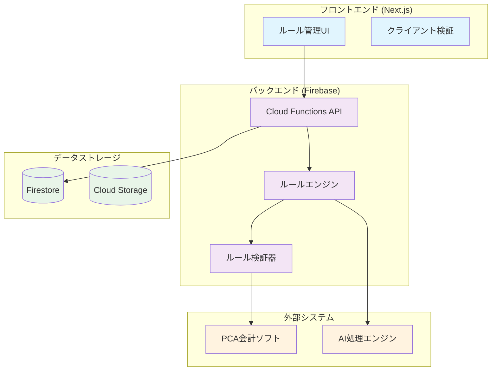
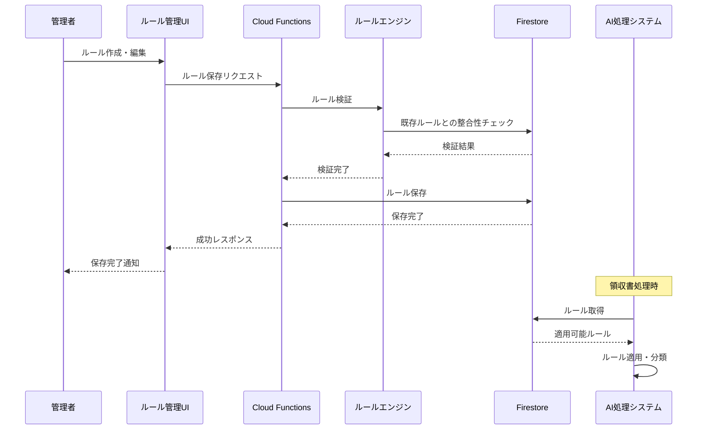

# 会計ルール管理システム設計書

## 概要

本設計書は、AI駆動の領収書処理システムにおける会計ルール管理機能の詳細設計を定義します。このシステムは、PCA会計ソフトウェアとの統合を前提とした複雑な会計ルールを管理し、AIが一貫した精度で領収書を自動分類・データ化できるようにします。

## アーキテクチャ

### システム構成図



### データフロー



## コンポーネントと インターフェース

### 1. ルール管理コンポーネント

#### AccountAssignmentRuleManager
勘定科目自動割り当てルールの管理を担当

```typescript
interface AccountAssignmentRuleManager {
  createRule(rule: AccountAssignmentRule): Promise<void>;
  updateRule(id: string, rule: Partial<AccountAssignmentRule>): Promise<void>;
  deleteRule(id: string): Promise<void>;
  getRules(filters?: RuleFilters): Promise<AccountAssignmentRule[]>;
  validateRule(rule: AccountAssignmentRule): ValidationResult;
  testRule(rule: AccountAssignmentRule, testData: ReceiptData[]): TestResult;
}
```

#### TaxAssignmentRuleManager
税区分自動判定ルールの管理を担当

```typescript
interface TaxAssignmentRuleManager {
  createRule(rule: TaxAssignmentRule): Promise<void>;
  updateRule(id: string, rule: Partial<TaxAssignmentRule>): Promise<void>;
  deleteRule(id: string): Promise<void>;
  getRules(filters?: RuleFilters): Promise<TaxAssignmentRule[]>;
  validateRule(rule: TaxAssignmentRule): ValidationResult;
  testRule(rule: TaxAssignmentRule, testData: ReceiptData[]): TestResult;
}
```

#### DepartmentCashMappingManager
部門・現金補助科目マッピングの管理を担当

```typescript
interface DepartmentCashMappingManager {
  createMapping(mapping: DepartmentCashMapping): Promise<void>;
  updateMapping(id: string, mapping: Partial<DepartmentCashMapping>): Promise<void>;
  deleteMapping(id: string): Promise<void>;
  getMappings(): Promise<DepartmentCashMapping[]>;
  validateMapping(mapping: DepartmentCashMapping): ValidationResult;
}
```

#### DataFormatSettingsManager
データフォーマット設定の管理を担当

```typescript
interface DataFormatSettingsManager {
  getSettings(): Promise<DataFormatSettings>;
  updateSettings(settings: Partial<DataFormatSettings>): Promise<void>;
  validateSettings(settings: DataFormatSettings): ValidationResult;
  resetToDefaults(): Promise<void>;
}
```

### 2. ルール検証エンジン

#### RuleValidator
ルールの整合性と完全性を検証

```typescript
interface RuleValidator {
  validateRuleSet(rules: ComprehensiveRuleSet): ValidationResult;
  checkRuleConflicts(newRule: Rule, existingRules: Rule[]): ConflictResult;
  validatePCACompliance(rules: ComprehensiveRuleSet): ComplianceResult;
  generateValidationReport(): ValidationReport;
}
```

### 3. ルール適用エンジン

#### RuleEngine
AIが領収書処理時に使用するルール適用エンジン

```typescript
interface RuleEngine {
  applyAccountRules(receiptData: ReceiptData): AccountAssignment;
  applyTaxRules(receiptData: ReceiptData, accountInfo: AccountAssignment): TaxAssignment;
  applyDepartmentRules(userId: string, receiptData: ReceiptData): DepartmentAssignment;
  applyFormatRules(processedData: ProcessedReceiptData): FormattedData;
  generateDescription(receiptData: ReceiptData): string;
}
```

## データモデル

### 既存マスターデータとの統合

既存のマスターデータ（Account, SubAccount, Tax, Department, Category）を活用し、ルール管理機能を追加します。

### 1. 勘定科目自動割り当てルール

```typescript
interface AccountAssignmentRule {
  id: string;
  name: string; // ルール名
  description?: string;
  
  // 条件設定（カテゴリを削除し、直接的な条件のみ使用）
  conditions: {
    expenseTypePatterns?: string[]; // 経費種別パターン（駐車場代、交通費など）
    merchantPatterns?: string[]; // 取引先パターン（正規表現）
    amountRange?: { min?: number; max?: number };
    keywords?: string[]; // 摘要キーワード
    receiptContentPatterns?: string[]; // 領収書内容パターン
  };
  
  // 割り当て設定（PCA仕様に準拠）
  assignment: {
    debitAccountCode: string; // 借方勘定科目コード (724, 726, 727, 729, 731, 733, 734, 737, 738, 754)
    debitAccountName: string; // 借方勘定科目名
    creditAccountCode: string; // 貸方勘定科目コード（111-現金固定）
    creditAccountName: string; // 貸方勘定科目名（現金固定）
    debitSubAccountCode?: string; // 借方補助科目コード（車両費729と租税公課738のみ）
    debitSubAccountName?: string; // 借方補助科目名
    creditSubAccountCode?: string; // 貸方補助科目コード（部門別）
    creditSubAccountName?: string; // 貸方補助科目名（支店名）
    taxCalculationMode: number; // 税計算モード（0 or 1）
  };
  
  priority: number; // 優先度（数値が小さいほど優先）
  isActive: boolean;
  effectiveFrom: Date;
  effectiveTo?: Date;
  createdAt: Date;
  updatedAt: Date;
  createdBy: string;
}
```

### 2. 税区分自動判定ルール

```typescript
interface TaxAssignmentRule {
  id: string;
  name: string;
  description?: string;
  
  // 判定条件（カテゴリを削除し、勘定科目コードベースに変更）
  conditions: {
    taxRate?: number; // 税率 (0.10, 0.08)
    invoiceCompliant?: boolean; // インボイス対応
    accountCodes: string[]; // 対象勘定科目コード（必須）
    specialAccountHandling?: { // 特別処理が必要な勘定科目
      '738': 'P0'; // 租税公課は常にP0（非仕入）
      '111': '00'; // 現金は常に00（対象外）
    };
  };
  
  // 税区分割り当て（PCA仕様準拠）
  assignment: {
    debitTaxCode: string; // 借方税区分コード (Q5-仕入10%, Q6-仕入8%軽, QD-仕入10%控80, QE-仕入8%軽控80, P0-非仕入, 00-対象外)
    creditTaxCode: string; // 貸方税区分コード (現金は常に00)
    taxCodeDescription: string; // 税区分説明
  };
  
  priority: number;
  isActive: boolean;
  effectiveFrom: Date;
  effectiveTo?: Date;
  createdAt: Date;
  updatedAt: Date;
  createdBy: string;
}
```

### 3. 部門・現金補助科目マッピング設定

```typescript
interface DepartmentCashMapping {
  id: string;
  departmentCode: string; // 部門コード (1, 2, 3, 4, 5, 6)
  departmentName: string; // 部門名
  cashAuxiliaryCode: string; // 現金補助科目コード (001, 002, 003, 005, 006)
  cashAuxiliaryName: string; // 現金補助科目名
  isActive: boolean;
  createdAt: Date;
  updatedAt: Date;
  createdBy: string;
}

// 注：ユーザーの部門情報は既存のユーザープロファイルから取得
```

### 4. データフォーマット設定

```typescript
interface DataFormatSettings {
  id: string;
  
  // 日付フォーマット
  dateFormat: string; // 'YYYYMMDD'
  
  // 摘要フォーマット
  descriptionTemplate: string; // '[{category} {merchant}]'
  
  // 固定値設定
  fixedValues: {
    programClassification: string; // '2'
    taxAmountHandling: 'blank' | 'calculated'; // 'blank' (内税計算のため空欄)
    amountType: 'tax_inclusive'; // 税込金額
  };
  
  // 検証ルール
  validation: {
    requiredFields: string[];
    maxAmountDigits: number;
    allowedCurrencies: string[];
  };
  
  isActive: boolean;
  createdAt: Date;
  updatedAt: Date;
  createdBy: string;
}
```

### 5. 包括的ルールセット

```typescript
interface ComprehensiveRuleSet {
  accountAssignmentRules: AccountAssignmentRule[];
  taxAssignmentRules: TaxAssignmentRule[];
  departmentCashMappings: DepartmentCashMapping[];
  formatSettings: DataFormatSettings;
  
  // メタデータ
  version: string;
  lastValidated: Date;
  validationStatus: 'valid' | 'invalid' | 'warning';
  validationErrors: ValidationError[];
  isActive: boolean;
  
  // 統計情報
  statistics: {
    totalRules: number;
    activeRules: number;
    lastApplied: Date;
    successRate: number;
  };
}
```

## エラーハンドリング

### エラー分類

1. **検証エラー**
   - ルール形式エラー
   - 必須フィールド不足
   - データ型不一致

2. **整合性エラー**
   - 重複ルール
   - 循環参照
   - 矛盾するルール設定

3. **PCA準拠エラー**
   - 無効な勘定科目コード
   - サポートされていない税区分
   - フォーマット不適合

### エラーハンドリング戦略

```typescript
interface ValidationResult {
  isValid: boolean;
  errors: ValidationError[];
  warnings: ValidationWarning[];
  suggestions: string[];
}

interface ValidationError {
  code: string;
  message: string;
  field?: string;
  severity: 'error' | 'warning' | 'info';
  context?: Record<string, any>;
}
```

## テスト戦略

### 1. 単体テスト
- 各ルール管理コンポーネントの個別機能テスト
- ルール検証ロジックのテスト
- データフォーマット変換のテスト

### 2. 統合テスト
- ルール作成から適用までの完全フローテスト
- Firebase Firestoreとの連携テスト
- PCAフォーマット出力の検証テスト

### 3. エンドツーエンドテスト
- 管理者によるルール設定シナリオ
- AI処理での実際のルール適用テスト
- エラーケースでの適切な処理確認

### テストデータ

```typescript
// テスト用のサンプルルールセット（カテゴリ削除後）
const testRuleSet: ComprehensiveRuleSet = {
  accountRules: [
    {
      id: 'account-001',
      name: '交通費自動割り当てルール',
      conditions: {
        expenseTypePatterns: ['交通費', '運賃', '電車代', 'バス代'],
        merchantPatterns: ['JR', '地下鉄', 'バス', '私鉄'],
        keywords: ['乗車券', '定期券', '回数券']
      },
      assignment: {
        debitAccountCode: '726',
        debitAccountName: '旅費交通費',
        creditAccountCode: '111',
        creditAccountName: '現金',
        taxCalculationMode: 1
      },
      priority: 1,
      isActive: true,
      // ... その他のフィールド
    },
    {
      id: 'account-002',
      name: '車両費自動割り当てルール（インボイス対応）',
      conditions: {
        expenseTypePatterns: ['駐車場代', 'ガソリン代', '高速代'],
        merchantPatterns: ['.*駐車場.*', '.*SS.*', '.*石油.*']
      },
      assignment: {
        debitAccountCode: '729',
        debitAccountName: '車両費',
        debitSubAccountCode: '001',
        debitSubAccountName: '課税事業者',
        creditAccountCode: '111',
        creditAccountName: '現金',
        taxCalculationMode: 1
      },
      priority: 2,
      isActive: true,
      // ... その他のフィールド
    }
  ],
  taxRules: [
    {
      id: 'tax-001',
      name: '10%税率インボイス対応ルール',
      conditions: {
        taxRate: 0.10,
        invoiceCompliant: true,
        accountCodes: ['724', '726', '727', '729', '731', '733', '734', '737', '754']
      },
      assignment: {
        debitTaxCode: 'Q5',
        creditTaxCode: '00',
        taxCodeDescription: '仕入10%'
      },
      priority: 1,
      isActive: true,
      // ... その他のフィールド
    },
    {
      id: 'tax-002',
      name: '租税公課専用ルール',
      conditions: {
        accountCodes: ['738']
      },
      assignment: {
        debitTaxCode: 'P0',
        creditTaxCode: '00',
        taxCodeDescription: '非仕入'
      },
      priority: 0, // 最高優先度
      isActive: true,
      // ... その他のフィールド
    }
  ],
  // ... その他のルール
};
```

## セキュリティ考慮事項

### アクセス制御
- ルール管理は `finance` および `admin` ロールのみ
- ルール閲覧は全社員可能
- 監査ログによる変更履歴の追跡

### データ保護
- ルール変更の承認ワークフロー
- バックアップとロールバック機能
- 機密情報の暗号化

### 入力検証
- SQLインジェクション対策
- XSS攻撃対策
- CSRFトークンの使用

## パフォーマンス最適化

### キャッシュ戦略
- ルールセットのメモリキャッシュ
- Firestore読み取り回数の最小化
- CDNを活用した静的リソース配信

### インデックス設計
```typescript
// Firestoreインデックス推奨設定
const recommendedIndexes = [
  'companies/{companyId}/accountRules: isActive+priority+effectiveFrom',
  'companies/{companyId}/taxRules: isActive+taxCode+effectiveFrom',
  'companies/{companyId}/departmentRules: isActive+departmentCode',
  'companies/{companyId}/formatRules: isActive+ruleType'
];
```

## 運用・保守

### モニタリング
- ルール適用成功率の監視
- エラー発生頻度の追跡
- パフォーマンスメトリクスの収集

### ログ管理
- ルール変更の詳細ログ
- AI適用結果のログ
- エラー発生時の詳細情報

### バックアップ・復旧
- 日次ルールセットバックアップ
- ポイントインタイム復旧機能
- 災害復旧計画

## 今後の拡張性

### 機械学習統合
- ルール適用結果の学習
- 自動ルール提案機能
- 精度向上のためのフィードバックループ

### API拡張
- 外部システムとの連携API
- ルールインポート/エクスポート機能
- バッチ処理API

### 多言語対応
- 国際化対応の準備
- 多通貨対応
- 地域別税制対応